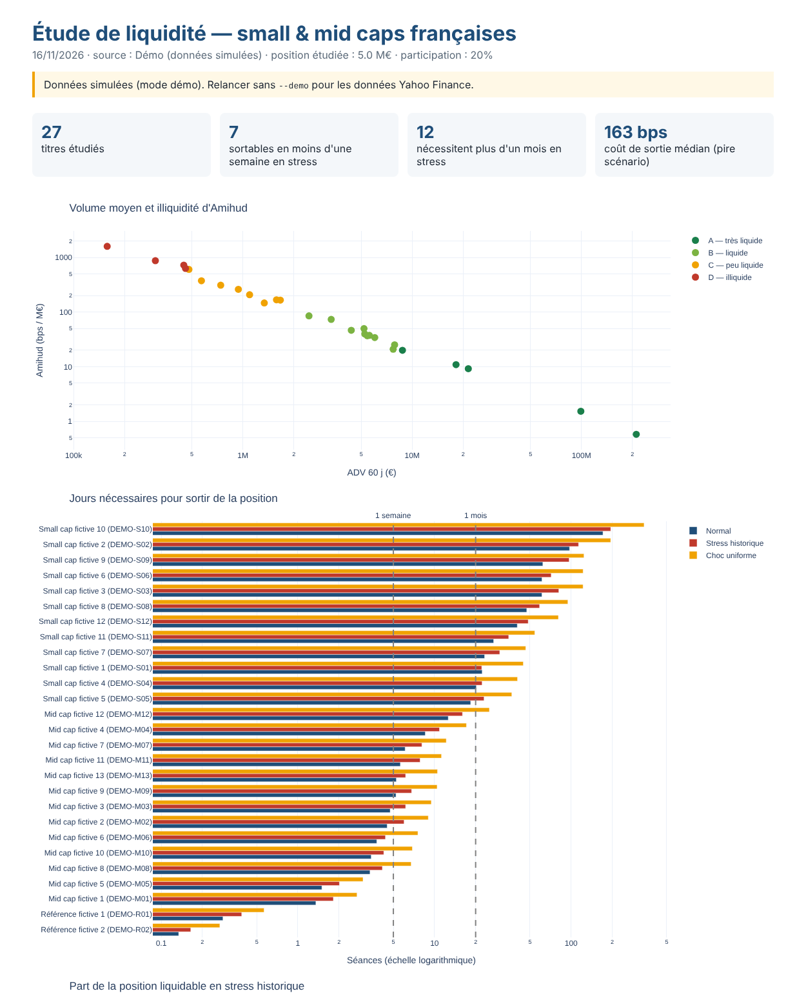

# Étude de liquidité — small & mid caps françaises

**Combien de temps faut-il pour sortir d'une position de 5 M€ sur une small cap française, et combien cela coûte-t-il, en temps normal comme en période de stress ?**

Ce projet mesure la liquidité de 25 small & mid caps d'Euronext Paris, avec deux large caps comme points de référence. Il produit un classement et un rapport prêt à partager (Excel + page HTML interactive).
Les questions traitées sont celles d'un desk actions face à un client institutionnel : taille de position raisonnable, rythme de sortie, coût d'exécution et risque de liquidité en marché tendu.



## Lancer l'étude

```bash
git clone https://github.com/Valentin-Knarov/french-smallcap-liquidity.git
cd french-smallcap-liquidity
pip install -r requirements.txt

python -m smallcap_liquidity                    # données réelles Yahoo Finance (5 ans)
python -m smallcap_liquidity --demo             # données simulées, sans connexion
python -m smallcap_liquidity --position 2000000 --participation 0.15
python -m smallcap_liquidity --tickers SOI.PA NEX.PA LSS.PA
```

Les rapports sont écrits dans `output/` :
- `etude_liquidite.xlsx` : synthèse, détail par scénario, paramètres et méthodologie ;
- `etude_liquidite.html` : graphiques interactifs, lisibles hors connexion.

Un exemple de classeur généré en mode démo est disponible dans [`docs/exemple_demo.xlsx`](docs/exemple_demo.xlsx).
En mode démo, les titres sont **fictifs** : des données simulées ne doivent pas porter le nom de vraies sociétés.

## Ce que mesure l'étude

### Notations

| Symbole | Signification |
|---|---|
| $P_t$ | cours de clôture du jour $t$ (€) |
| $N_t$ | volume échangé le jour $t$ (titres) |
| $r_t$ | rendement logarithmique du jour $t$ : $\ln(P_t / P_{t-1})$ |
| $H_t$, $L_t$ | plus haut et plus bas du jour $t$ |
| $X$ | taille de la position à vendre (€), 5 M€ par défaut |
| $V$ | volume journalier de référence du scénario (€) |
| $p$ | taux de participation au volume, 20 % par défaut |
| $\sigma$ | volatilité journalière |
| $s$ | spread acheteur-vendeur relatif |
| $Y$ | constante d'impact, 0,7 par défaut |
| $d$ | nombre de séances |

### 1. Indicateurs de liquidité

- **Volume moyen journalier (ADV, 60 séances)** en euros, $\overline{P_t N_t}$, et sa médiane, plus représentative quand quelques séances exceptionnelles tirent la moyenne.
- **Ratio d'Amihud (2002)** : $\text{ILLIQ} = \overline{\,|r_t| \,/\, (P_t N_t)\,}$, exprimé en bps par million d'euros échangé. Il mesure de combien le prix bouge pour 1 M€ échangé : plus il est élevé, moins le titre est liquide.
- **Spread estimé** par la méthode de Corwin & Schultz (2012), à partir des plus hauts et plus bas journaliers :

$$\beta = \left[\ln\tfrac{H_t}{L_t}\right]^2 + \left[\ln\tfrac{H_{t+1}}{L_{t+1}}\right]^2,\quad
\gamma = \left[\ln\tfrac{\max(H_t,H_{t+1})}{\min(L_t,L_{t+1})}\right]^2,\quad
\alpha = \tfrac{\sqrt{2\bar\beta}-\sqrt{\bar\beta}}{3-2\sqrt2} - \sqrt{\tfrac{\bar\gamma}{3-2\sqrt2}},\quad
s = \tfrac{2(e^\alpha-1)}{1+e^\alpha}$$

  Ici, $\bar\beta$ et $\bar\gamma$ sont les moyennes de $\beta$ et $\gamma$ sur 6 mois. Un plancher de 2 bps est appliqué : en dessous, l'estimateur ne distingue plus le spread du bruit.
- **Séances sans volume** : part des jours sans aucune transaction, un signal d'illiquidité extrême.

### 2. Liquidité de sortie

$$\text{jours de sortie } D = \frac{X}{p\,V} \qquad
\text{part liquidable en } d \text{ séances} = \min\!\left(1, \frac{p\,V\,d}{X}\right) \qquad
\text{coût de sortie} = \frac{s}{2} + Y\,\sigma\,\sqrt{p}$$

Le coût de sortie additionne le demi-spread et l'impact de marché, selon la loi en racine carrée. La part liquidable est donnée à 1, 5 et 20 séances, comme dans les grilles de stress de liquidité des fonds.

### 3. Trois scénarios

| Scénario | Volume $V$ | Volatilité $\sigma$ | Spread $s$ |
|---|---|---|---|
| **Normal** | médiane des 60 dernières séances | 60 dernières séances | 6 derniers mois |
| **Stress historique** | 10e centile du volume médian glissant sur 20 j | 90e centile de $\sigma$ glissante sur 20 j | 90e centile du spread glissant sur 60 j |
| **Choc uniforme** | normal − 50 % | normal × 2 | normal × 2 |

Le stress historique est **propre à chaque titre** : il reprend ses pires périodes sur 5 ans, comme mars 2020 ou les épisodes de marché de 2022. Il combine volontairement les trois pires niveaux. La synthèse retient le **pire des trois scénarios**.

### 4. Score et classes

Le score (0–100) est la moyenne des rangs centiles de cinq indicateurs : ADV, Amihud, spread, séances sans volume et jours de sortie en stress (100 = plus liquide).
On utilise des rangs pour que le score ne dépende ni des unités ni des valeurs extrêmes.
Classes : **A** ≥ 75 (très liquide), **B** ≥ 50, **C** ≥ 25, **D** < 25 (illiquide).
Le classement est **relatif** à l'univers étudié.

## Structure du code

```
smallcap_liquidity/
├── universe.py   # titres étudiés (+ univers fictif du mode démo)
├── data.py       # Yahoo Finance + simulation (avec épisode de stress)
├── metrics.py    # ADV, Amihud, spread Corwin-Schultz, volatilité, séances sans volume
├── exit.py       # scénarios normal / stress / choc et liquidité de sortie
├── study.py      # synthèse, score, classes
├── report.py     # rapports Excel et HTML
└── __main__.py   # ligne de commande
tests/            # pytest
```

## Limites

- **Données gratuites journalières** : pas de carnet d'ordres ni de volumes par plateforme. Le volume Yahoo couvre Euronext ; les plateformes alternatives et les blocs hors marché ne sont pas comptés.
- **Spread estimé** : ordre de grandeur, bruité sur les valeurs les plus liquides.
- **Constante d'impact $Y$ non calibrée** : il faudrait l'ajuster sur des exécutions réelles.
- **Participation fixe à 20 %** : en pratique, on adapte le rythme au besoin du client et au risque de signal.
- **Pistes** : ajouter le flottant et la rotation du capital, la part du fixing de clôture, et des alertes quand la liquidité se dégrade.

## Références

- Amihud, Y. (2002). *Illiquidity and stock returns: cross-section and time-series effects*. Journal of Financial Markets.
- Corwin, S. & Schultz, P. (2012). *A Simple Way to Estimate Bid-Ask Spreads from Daily High and Low Prices*. Journal of Finance.
- ESMA (2020). *Guidelines on liquidity stress testing in UCITS and AIFs*.

---

*Projet personnel de Valentin Knarov (emlyon business school, PGE & licence de mathématiques à Lyon 1).
Étude indicative : ne constitue pas un conseil d'investissement.*
